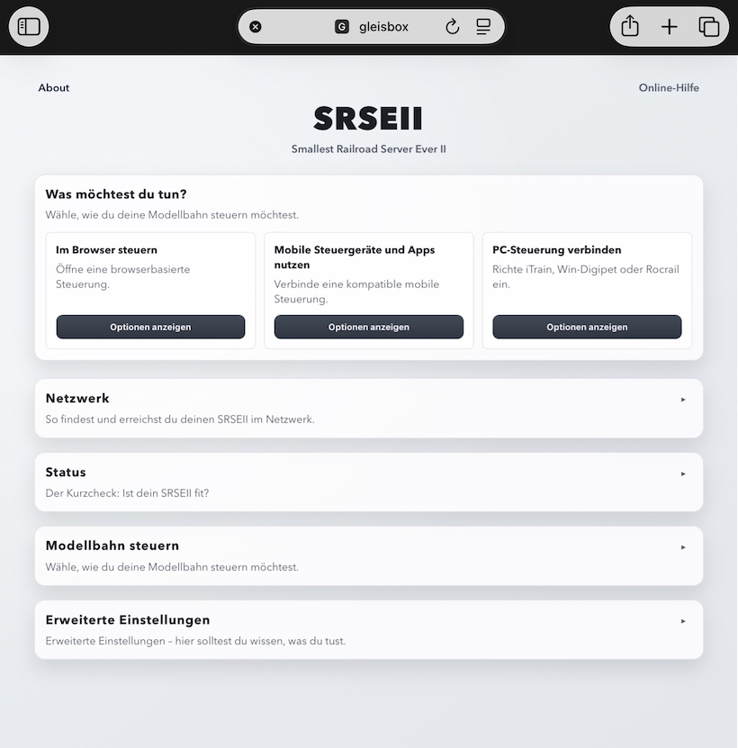
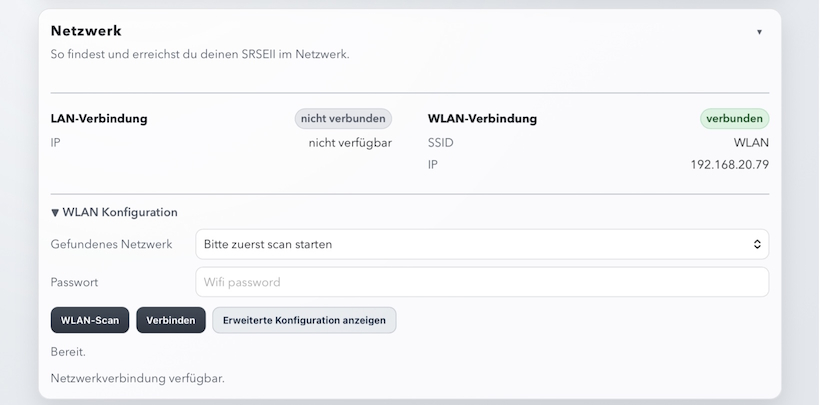
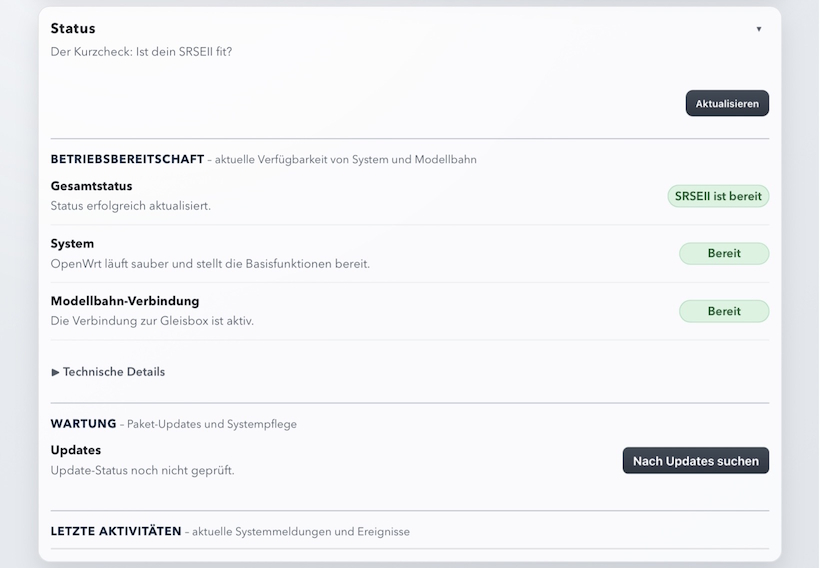
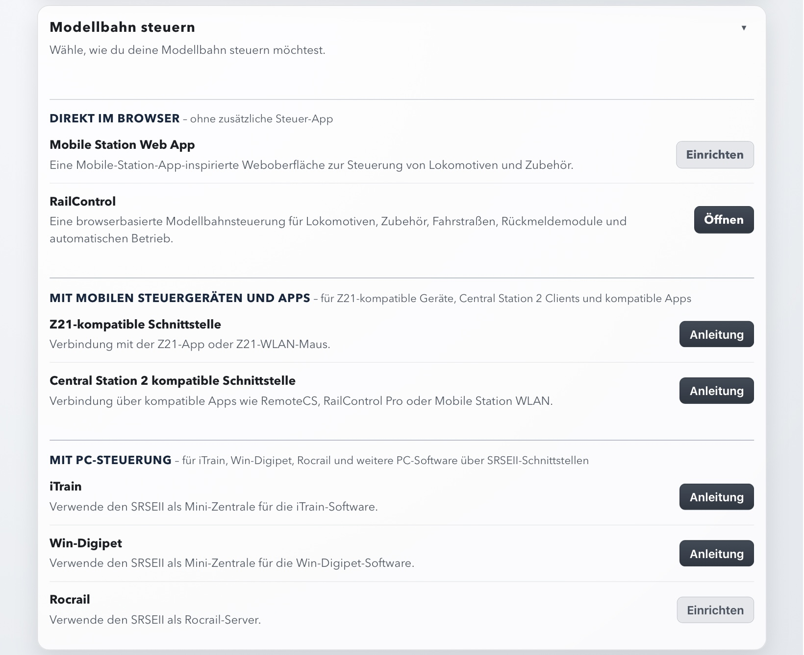
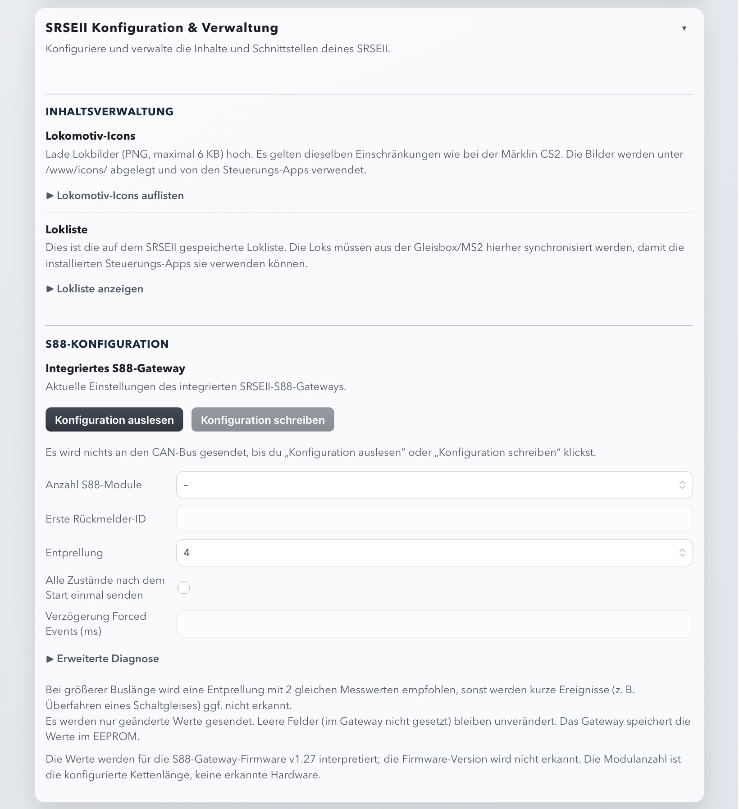

# SRSEII Portal

## Deutsch

Das **SRSEII Portal** ist ein einfaches Webinterface, um den SRSEII für die
Modellbahn einzurichten und zu konfigurieren – ohne Linux- oder OpenWrt-Kenntnisse.
Es unterstützt Anwendungen rund um Märklin-Gleisbox und Mobile Station.
Das Portal ist auf Deutsch, Englisch, Niederländisch und Französisch verfügbar.

- WLAN einrichten und den Systemstatus prüfen
- Updates starten und Modellbahn-Funktionen mit Assistenten einrichten
- Modellbahn-Apps öffnen und bei Bedarf LuCI als Expertenoberfläche nutzen

### Installation

Über die Paketverwaltung des SRSEII, per SSH:

```sh
opkg update && opkg install srseiiportal
```

Alternativ per SSH: Die URL des `srseiiportal_*_mipsel_24kc.ipk`-Pakets von
den [Releases](https://github.com/RalfMende/SRSEIIPortal/releases) kopieren und einsetzen:

```sh
cd /tmp && \
wget -O srseiiportal.ipk 'PAKET-URL' && \
opkg install srseiiportal.ipk
```

Nicht jedes Release enthält ein IPK; ein älteres Paket installiert eine ältere
Version.

### Verwendung

Das Portal ist dann unter `http://gleisbox` bzw. `http://<host>` erreichbar.
LuCI bleibt unter `http://gleisbox/cgi-bin/luci/` erreichbar.

Mehr Informationen und Bilder im [Stummiforum](https://www.stummiforum.de/t246231f7-Einfaches-Portal-zur-Einrichtung-des-SRSEII.html#msg2965595).

## English

The **SRSEII Portal** is a simple web interface for setting up and configuring
the SRSEII for your model railway – no Linux or OpenWrt knowledge required.
It supports applications for the Märklin Gleisbox and Mobile Station.
The portal is available in English, German, Dutch and French.

- Set up Wi-Fi and check the system status
- Start updates and set up model railway functions using guided assistants
- Open model railway apps and use LuCI as an expert interface when needed

### Installation

Using the SRSEII package manager over SSH:

```sh
opkg update && opkg install srseiiportal
```

Alternatively, over SSH: copy the URL of the `srseiiportal_*_mipsel_24kc.ipk`
package from [releases](https://github.com/RalfMende/SRSEIIPortal/releases)
and insert it below:

```sh
cd /tmp && \
wget -O srseiiportal.ipk 'PACKAGE-URL' && \
opkg install srseiiportal.ipk
```

Not every release contains an IPK; an older package installs an older version.

### Use

Afterwards, the portal can be opened at `http://gleisbox` or `http://<host>`.
LuCI remains accessible at `http://gleisbox/cgi-bin/luci/`.

For more information, visit the [Stummiforum thread](https://www.stummiforum.de/t246231f7-Einfaches-Portal-zur-Einrichtung-des-SRSEII.html#msg2965595) (German).

### Screenshots









#SRSEII #Modellbahn #Märklin #OpenWrt
