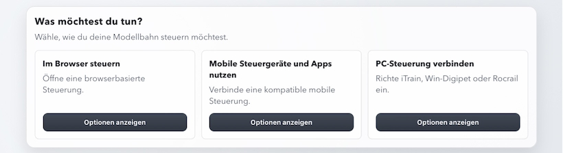
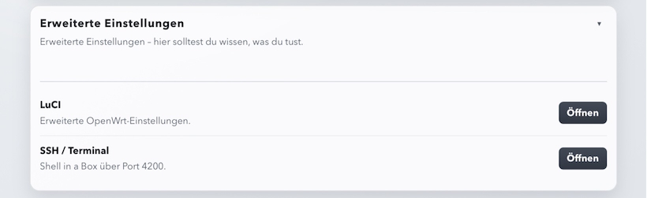

# SRSEII Portal

## Deutsch

Das **SRSEII Portal** ist eine komfortable Weboberfläche zur Einrichtung, Konfiguration und Verwaltung des SRSEII. Es macht viele Funktionen des SRSEII direkt im Browser zugänglich – übersichtlich und ohne Linux- oder OpenWrt-Kenntnisse.

Das Portal unterstützt Anwendungen rund um die Märklin-Gleisbox und Mobile Station und ist in Deutsch, Englisch, Niederländisch und Französisch verfügbar.

Status: Released

### Installation

Das SRSEII Portal ist offiziell im SRSEII-Feed von Gerd verfügbar.

Die Installation erfolgt bequem über die Paketverwaltung des SRSEII. Suche dort nach srseiiportal und installiere das Paket.

Nach der Installation ist das Portal direkt über den Browser erreichbar.

### Funktionen

Das SRSEII Portal bietet unter anderem folgende Funktionen:

- **Systemübersicht**: Wichtige Informationen und Status des SRSEII auf einen Blick.
- **WLAN-Assistent**: Unterstützung bei der Einrichtung der WLAN-Verbindung.
- **Updates**: Firmware- und Software-Updates bequem über die Weboberfläche starten.
- **Einrichtungsassistenten**: Unterstützung bei der Konfiguration verschiedener Modellbahn-Funktionen.
- **Lokliste**: Lokomotiven verwalten und mit der Mobile Station synchronisieren; Einträge können bei Bedarf zurückgesetzt oder einzeln entfernt werden.
- **Weitere Anwendungen**: Modellbahn-Anwendungen direkt aus dem Portal aufrufen.
- **Expertenwerkzeuge**: Zugriff auf LuCI und Shell-In-A-Box für weitergehende Einstellungen und administrative Aufgaben.

### Aufruf

Das Portal erreichst du nach der Installation im Browser unter: `http://gleisbox` bzw. `http://<host>`

Die LuCI-Oberfläche ist weiterhin direkt erreichbar unter:
`http://gleisbox/cgi-bin/luci/`

### Screenshots

Siehe unten

### Weitere Informationen und Austausch

Fragen, Anregungen und Rückmeldungen sind im Stummiforum willkommen:
[SRSEII Portal – Diskussion im Stummiforum](https://www.stummiforum.de/t246231f7-Einfaches-Portal-zur-Einrichtung-des-SRSEII.html#msg2965595).

## English

The **SRSEII Portal** is a convenient web interface for setting up, configuring and managing the SRSEII. It makes many SRSEII functions accessible directly in your browser – without requiring Linux or OpenWrt knowledge for everyday use.

The portal supports applications around the Märklin track box and Mobile Station. It is available in German, English, Dutch and French.

Status: Released

### Installation

The SRSEII Portal is officially available in Gerd's SRSEII package feed.

Open the SRSEII package manager, search for srseiiportal and install the package.

### Features

- **System overview**: Important SRSEII information and status at a glance.
- **WLAN assistant**: Help with setting up the wireless network connection.
- **Updates**: Start firmware and software updates through the web interface.
- **Setup assistants**: Configure various model railway functions.
- **Locomotive list**: Manage locomotives and synchronize them with the Mobile Station.
- **Applications**: Open model railway applications directly from the portal.
- **Advanced tools**: Access LuCI and Shell-In-A-Box for advanced configuration and administration.

### Access

Open the portal in your browser:
 `http://gleisbox` or `http://<host>`

The LuCI interface is also available at:
`http://gleisbox/cgi-bin/luci/`

### Feedback and discussion

Questions, suggestions and feedback are welcome in the [Stummiforum discussion](https://www.stummiforum.de/t246231f7-Einfaches-Portal-zur-Einrichtung-des-SRSEII.html#msg2965595) (German).

### Screenshots

#SRSEII #Modellbahn #Märklin #OpenWrt
